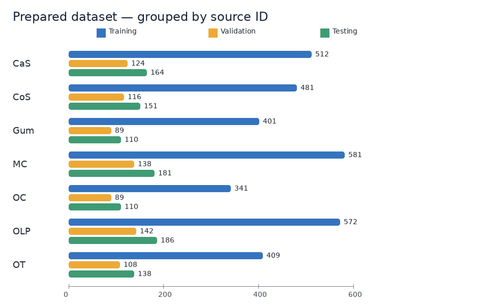
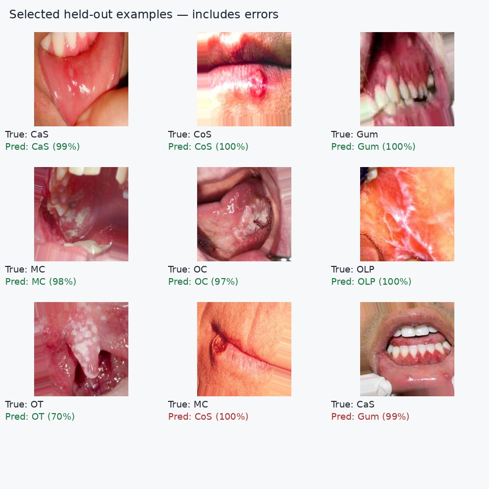

# Dental image AI

This repository contains three separate computer-vision tracks and a Streamlit
demo that lets you choose the task. The current `Teeth_Dataset.zip` supports only
seven-way image classification. It has no bounding boxes or segmentation masks.
See [`docs/resource_review.md`](docs/resource_review.md) for the review of the
existing notebook, dataset integrity, and the linked tutorials.

## What's in the repository

- `classification/`: MobileNet and EfficientNet training and held-out evaluation for the seven
  class folders: CaS, CoS, Gum, MC, OC, OLP, and OT.
- `detection/`: setup notes for object detection. It needs images with bounding-box
  annotations before a detector can be trained.
- `segmentation/`: setup notes for segmentation. It needs paired dental images and
  masks. The linked U-Net notebook points to an **eye** dataset, so those weights
  would not be suitable for dental images.
- `app.py`: upload an image and select classification, bounding-box detection, or
  segmentation. It shows a clear message when weights for a task are unavailable.

## Prepare and train classification

Install dependencies and prepare the dataset archive. The preparation script
ignores output folders accidentally included in the ZIP and makes a new split by
the numeric image/source ID because the original split reuses IDs across train,
validation, and test.

```bash
python -m pip install -r requirements-training.txt
python tools/prepare_teeth_data.py "/path/to/Teeth DataSet.zip"
python classification/train.py --data data/teeth_clean
streamlit run app.py
```

The default uses an ImageNet-pretrained MobileNet checkpoint from the GitHub
release linked in the training script. If you have access to Keras model hosting,
you can choose `--weights imagenet` for EfficientNetB0. For an offline run, use
`--weights none`; this uses a smaller CNN trained from scratch at 128×128.

The best classifier is saved as `models/classification.keras`. The metrics and
confusion matrix are saved next to it. The classifier is an experimental
educational model, not a diagnostic tool.

The current CPU-trained MobileNet scores 57.0% accuracy and 0.545 macro F1 on
the source-ID-grouped held-out test set. This is useful for trying the app, but
the class recalls vary substantially, so do not use its predictions for clinical
decisions.

### Dataset and prediction examples

The chart shows the prepared training, validation, and test counts for each class.



These held-out examples show one correct prediction per class and two mistakes.
They illustrate the labels and failure cases; use the aggregate test metrics above
to judge performance.



## Detection and segmentation

The app already supports inference for weights placed at
`models/detection.pt` (Ultralytics) and `models/segmentation.keras` (binary Keras
mask model). Those models cannot be trained from the supplied teeth archive.
Provide dental box labels and paired dental masks to enable those tracks. The
Drive videos are tutorials, not labeled training data.

## Publish the Streamlit app

The classifier weights and class names are included in this repository so the
deployed app can make predictions without the training dataset. On
[Streamlit Community Cloud](https://share.streamlit.io/), create a new app and
select this repository, branch `main`, and main file path `app.py`. Keep
`requirements.txt` as the dependency file, choose Python 3.12 in Advanced
settings, then deploy. Streamlit will provide a shareable app URL after the first
build finishes.

The app currently has working classification weights. The bounding-box and
segmentation choices will show an unavailable-model message until dental box
annotations and dental masks are supplied and those models are trained.
